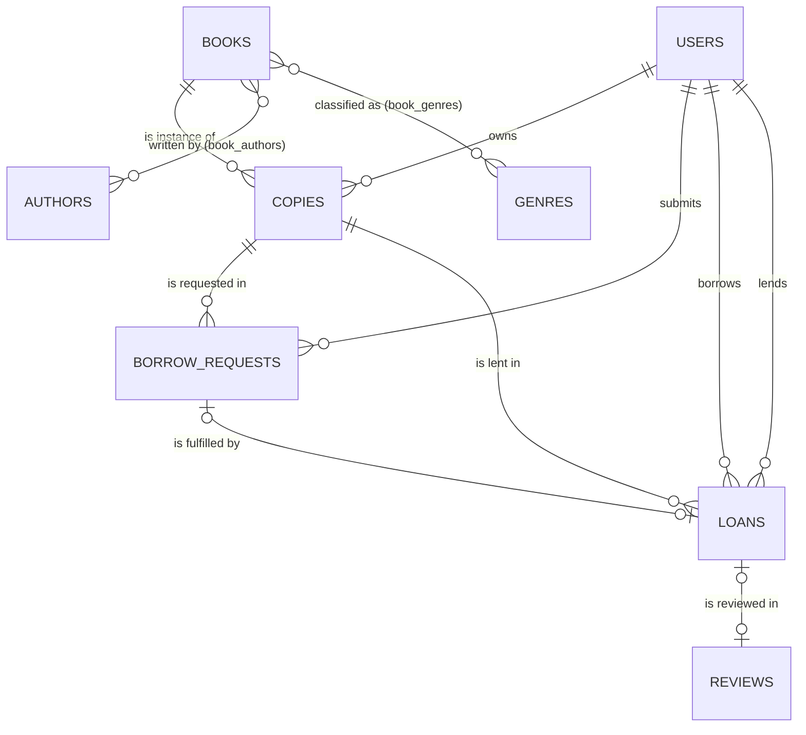

# BookLoop — Phase 0 Database & Requirements Design Review

**Course:** BCSE302P — Database Systems Lab
**Status:** DESIGN REVIEW ONLY. No application code written, no database touched, no SQL executed.
**Inputs reviewed:** `DB_project_overview (2).pdf` (2 pp.), `BookLoop_Project_Requirements_Document.docx` (PRD).
**Awaiting:** project owner's approval of Section 13 decisions before any migration is written.

> **Update:** D-1…D-12 were approved with defaults. The schema, trigger set and lock protocol in this file have since been revised by a consistency pass. **`PROPOSED_SCHEMA_V1.md` is the document of record; where the two differ, it wins.** Notably: delist guard and listed/owner-active checks moved out of triggers, `cancelled_by` added, uniform copy→request→loan lock order, event timestamps use `clock_timestamp()`, custom SQLSTATE class is `LD` (not `BL`).

---

## 0. Evidence basis and limits (read first)

| Label | Meaning |
|---|---|
| **VERIFIED** | Established by reading the two input documents. |
| **STATIC** | Reasoned from documented PostgreSQL semantics. Not executed. Needs a runtime test before it is trusted. |
| **ASSUMPTION** | A choice I am proposing that you must confirm. |

* **VERIFIED:** the PRD contains **no SQL DDL, no index list and no view definitions.** The docx has no embedded SQL, comments or footnotes. `C:\Users\Soumya Sharma\BookLoop` was empty. So there is no "suggested schema" to review line by line. This review audits the schema the PRD *specifies* (entities, relationships, constraints, lifecycle) and proposes concrete DDL in §9. If you have a separate SQL file, send it and I will diff it against §9.
* **No PostgreSQL instance was used.** Everything in §9 is unvalidated SQL. Statements such as "this will raise 23505" are STATIC until the Phase 1 test suite runs.
* The DDL in §9 is a design proposal in a document. It is not a migration file.

---

## 1. Executive verdict

**Not ready to implement as written. Close, and fixable with small changes.**

The PRD's modelling instincts are sound:

* Books and copies are separate.
* Requests and loans are separate.
* Overdue status is derived, not stored.
* Cascading deletes are avoided.
* Partial unique indexes are named for the two key exclusivity rules.

Six things stop me from calling it implementation-ready:

1. **The concurrency protocol is under-specified.** "Lock the copy/request rows" does not say which row first, or what the lock must cover. Partial unique indexes alone leave a real hole (C-1).
2. **The lifecycle has dead ends.** `CANCELLED` has no defined origin. Approved reservations never expire. The actors for handoff and return are undefined (C-2).
3. **The loan↔request match is only half-specified.** The loan has its own `copy_id`, `borrower_id` and `lender_id`, and nothing declaratively ties them to the request (C-3).
4. **The overview and PRD disagree** on whether availability is trigger-maintained or derived (H-1).
5. **Several business rules are undefined** (§5): review policy, deactivation consequences, contact exchange, duplicate requests, and the policy for requesting a copy that is on loan.
6. **The test plan is missing the tests that would catch the hardest bugs.**

None of this needs a redesign. It needs about eight explicit decisions (§13), roughly six extra constraints, and a documented lock order.

---

## 2. Critical issues (fix before any implementation)

### C-1 — CRITICAL — Check-then-act is unsafe under READ COMMITTED unless the copy row is locked first

* **Current design (PRD §8.2):** "lock the copy/request rows; verify…; update; commit". Two partial unique indexes back it up.
* **Problem (STATIC):**
  * PostgreSQL's default isolation is READ COMMITTED, and each statement gets a fresh snapshot.
  * Suppose approval of request B runs `SELECT … active loan?` (nothing found, because handoff of A is uncommitted), then `SELECT … approved?` after A's handoff commits (A is now FULFILLED, so nothing found), then `UPDATE B → APPROVED`.
  * Both checks pass, and the unique index on `status='APPROVED'` does not fire because A is no longer APPROVED.
  * Result: B is APPROVED while A's loan is active.
  * No index can prevent this. "Approved" lives in `borrow_requests` and "active loan" lives in `loans`, so no single unique index spans both.
* **Proposed change:** the **`copies` row is the mutex**.
  * Every transaction that changes a copy's state takes `SELECT … FROM copies WHERE id=$1 FOR UPDATE` **as its first statement**. This covers approve, handoff, return, cancel-approved, delist.
  * After the lock is acquired, all later statements run with post-wait snapshots, so the checks are consistent.
  * Lock order is always **copy → request → loan**, to avoid deadlocks.
  * Guard triggers (§9) re-acquire the copy lock so correctness does not depend only on service discipline.
* **Why better:** it turns an implicit "careful coding" rule into a protocol that can be tested with two concurrent clients.
* **Trade-off:** per-copy serialisation, which is irrelevant at this scale. Waiting transactions need `SET LOCAL lock_timeout`.
* **Essential.**

### C-2 — CRITICAL — The request/loan lifecycle is incomplete

* **Current design (PRD §7):** only the happy path is described. `CANCELLED` appears in the state list but no transition leads to it.
* **Problems:**
  * An `APPROVED` request that nobody collects blocks the copy forever (it counts as a reservation). There is no exit.
  * FR-06 and FR-07 say "authorized users" without saying who.
  * Nothing says what happens to sibling `PENDING` requests when one is approved.
  * A loan that is never returned (lost book) holds the copy forever, and `delist` is blocked.
* **Proposed change:** the explicit transition table in §6.5 plus these ASSUMPTIONS:
  * **Owner** records handoff and return (the owner physically has the book). Admin may do either as an override.
  * **Requester** may cancel `PENDING` or `APPROVED`. **Owner** may cancel `APPROVED` (e.g. no-show).
  * Sibling `PENDING` requests stay `PENDING`. A natural waitlist, and it avoids polluting the approval/rejection statistics.
  * Lost-book handling: **out of scope for v1, documented as a limitation.** If you later want it, add `closed_at` + `outcome IN ('RETURNED','LOST')`.
* **Essential.**

### C-3 — CRITICAL — Loan fields can contradict the request

* **Current design:** `loans` holds `request_id` (unique) plus borrower, lender and copy. PRD §8.3 says to use "triggers or other suitable safeguards".
* **Problem:** with plain FKs, a loan can reference request R (copy X, requester U) while storing `copy_id = Y`. That is wrong data. A trigger can check it, but triggers can be bypassed, disabled, or race with updates.
* **Proposed change (declarative, no trigger):**
  * `borrow_requests` gets `UNIQUE (id, copy_id, requester_id)`.
  * `loans` gets `FOREIGN KEY (request_id, copy_id, borrower_id) REFERENCES borrow_requests (id, copy_id, requester_id)`.
  * `copies` gets `UNIQUE (id, owner_id)`.
  * `loans` gets `FOREIGN KEY (copy_id, lender_id) REFERENCES copies (id, owner_id)`.
  * `loans` gets `CHECK (borrower_id <> lender_id)`.
* **Why better:**
  * The database *proves* the loan matches the request and that the lender is the owner at handoff.
  * Changing `copies.owner_id` while loans exist fails with FK error 23503, so ownership history cannot be silently rewritten.
* **Trade-off:** three extra "redundant" unique constraints (they exist only as FK targets), and `copy_id` / `borrower_id` / `lender_id` are deliberate cross-table duplicates (see §8).
* **Essential.**

---

## 3. High-severity findings

| ID | Finding | Fix |
|---|---|---|
| **H-1** | **Overview ↔ PRD contradiction.** The overview says "a trigger updates a copy's availability the moment a lending transaction opens or closes" and models one `Lending_Transactions` table. The PRD says derive availability and avoid redundant status fields, and splits requests from loans. | Follow the PRD. **Availability is a view.** The report must explain that "automatic status tracking" is realised by the derived `available_copies` view plus guard triggers, and that `Lending_Transactions` was refined into `borrow_requests` + `loans` because a single table cannot represent rejected requests without NULL-heavy rows. **Decision D-1.** |
| **H-2** | **Duplicate open requests are not prevented.** The same member can create ten `PENDING` requests for one copy. | Partial unique index `(copy_id, requester_id) WHERE status IN ('PENDING','APPROVED')`. |
| **H-3** | **Request policy is ambiguous.** §7 says "request a listed copy". §9 says search shows only "currently eligible" copies. Can you request a copy that is currently on loan, i.e. is there a waitlist? | Recommended **Rule A:** a request may be created only when the copy is currently available. Multiple `PENDING` from different members are allowed. Approval re-checks under lock. **Decision D-3.** |
| **H-4** | **Review policy is unspecified** (the PRD itself says it must be explicit). | **Recommended:** the borrower of a returned loan may review the *book* once (1–5, optional comment). Lender-rates-borrower is out of scope. Reviewer is derived from `loans.borrower_id`, with no `reviewer_id` column. **Decision D-4.** |
| **H-5** | **Deactivation semantics undefined**, and token-based auth keeps working after deactivation. | The auth middleware loads the user from the DB on each request (`deactivated_at IS NULL`), or uses server-side sessions. A JWT alone is **not** acceptable because it cannot be revoked. Define the effects in §6.6. |
| **H-6** | **No way to coordinate pickup.** Chat is out of scope, and nothing tells a borrower where or how to collect. The handoff cannot be demonstrated sensibly. | `users.contact_info` (optional) and `users.default_pickup_location`. Contact info is returned **only** to the counterparty on an `APPROVED` request or active loan. **Decision D-6.** |
| **H-7** | **Ownership transfer is mentioned (§8.3) but has no feature.** | Declare "no transfer in v1". Enforced by C-3's FK plus a guard on `owner_id` updates. This also makes "historical ownership" trivially correct. |
| **H-8** | **FRs without endpoints.** FR-03 (list/unlist/edit copy), FR-11 (review), FR-13 (deactivate), request cancel, "my requests" and "incoming requests" lists, current user (`/me`), logout. | Extend §12 of the PRD (see §5.4 below). |
| **H-9** | **Deadlock/error handling not specified.** | Map SQLSTATEs: 23505 → 409 (by constraint name), 23503 → 409/400, 23514 → 422, 55P03 (lock timeout) → 409/503, 40P01 (deadlock) → retry once. Custom trigger errors use `ERRCODE = 'BL001'`–`'BL0xx'`. |

---

## 4. Major (MEDIUM) improvements

| ID | Change | Why |
|---|---|---|
| M-1 | Case-insensitive email: **`citext` column + `UNIQUE`**, with app-side `trim()`. Alternative: `UNIQUE INDEX ON users (lower(email))`. | Plain `UNIQUE(email)` does not meet the PRD. citext is simplest because `WHERE email = $1` just works. **Unverified:** extension availability on your Neon project. Run `CREATE EXTENSION IF NOT EXISTS citext;` in Phase 1. |
| M-2 | `status` / `role` / `condition` as **`TEXT` + named `CHECK`**, not PG `ENUM`. | Adding a value to an ENUM is awkward in migrations; CHECK is easy to alter and explain. |
| M-3 | Status↔timestamp coherence CHECKs on `borrow_requests` (§9). | Prevents `APPROVED` with `decided_at NULL`, and similar. |
| M-4 | `users.deactivated_at` only, **no** `is_active` boolean. | Two columns can contradict. `deactivated_at IS NULL` ≡ active. |
| M-5 | `copies.is_listed BOOLEAN` is *owner intent*, **not** availability. | Resolves the PRD's "listing status" vs "no redundant status fields" tension. |
| M-6 | `book_authors.author_order` + `UNIQUE (book_id, author_order)`. | Author order matters on a cover; a bare junction loses it. |
| M-7 | `users.default_pickup_location` plus nullable `copies.pickup_location` override, displayed with `COALESCE`. | Avoids stale duplicate addresses when the owner moves. |
| M-8 | Due date: default 14 days, owner may choose 1–60 at handoff, stored as end-of-day in campus timezone (`Asia/Kolkata`). **Decision D-5.** | Avoids "overdue at 10:07 AM"; keeps `TIMESTAMPTZ`. |
| M-9 | Accountability rule: a member with ≥1 overdue loan cannot create new requests. | The overview's gap analysis is explicitly about *accountability*, yet the PRD has no consequence for lateness. One `EXISTS` query demonstrates it. **Decision D-7.** |
| M-10 | Seed script must replay the real lifecycle (PENDING→APPROVED→loan→FULFILLED) with explicit historical timestamps and refuse to run unless `ALLOW_SEED=true`. | The guard triggers will (correctly) reject shortcut inserts. Neon does not give you `session_replication_role = replica`. |
| M-11 | Neon: run migrations on the **direct** (non-pooled) connection string. Use the pooled string for the app. Add `pool.on('error')`, short `idleTimeoutMillis`, and `connectionTimeoutMillis` for compute cold starts. | **STATIC/unverified:** pooler (PgBouncer transaction mode) is incompatible with session-level advisory locks used by many migration runners. |
| M-12 | Run integration tests on a **separate Neon branch**, never the dev branch. | Tests truncate. Branching is the safe way. |
| M-13 | Pagination (`limit`/`offset` or keyset) on every list endpoint. | PRD never specifies it. |
| M-14 | Login rate limiting; registration must ignore any `role` field (mass-assignment); admin bootstrapped only via seed/CLI. | Direct consequence of PRD §4 "do not trust admin roles from the browser". |

---

## 5. Requirements review

### 5.1 Missing

* Actors and authority for handoff, return and cancel (C-2).
* Reservation expiry or release (C-2).
* Waitlist/request policy (H-3).
* Contact/pickup exchange (H-6).
* Overdue consequences (M-9).
* Lost or damaged books (limitation).
* What deactivation does to open requests and loans (§6.6).
* Book-catalogue governance: who may create or edit `books`? Any member can `POST /api/books`, so duplicates and vandalism are likely. **Recommend:** members create, only admin edits/merges.
* Pagination, sorting and search filters.
* Measurable non-functional targets (e.g. "search < 300 ms on 30 titles / 40 copies, evidence = `EXPLAIN ANALYZE`"). "Indexes support common lookups" is not testable.
* Accessibility standard ("WCAG 2.1 AA, verified with Lighthouse + keyboard walkthrough").
* Time zone policy.
* Metric definitions for analytics (see §5.5).

### 5.2 Ambiguous

* "Authorized users can record returns" (FR-07).
* "Reviews restricted to eligible completed loans": eligible by whom, and for what?
* "Transfer" in §8.3.
* "Outstanding approved reservation": the duration is unbounded.
* "Condition, where relevant": **recommendation:** condition is informational and does *not* affect availability. An owner who considers a book unfit simply unlists it.

### 5.3 Conflicts

| Source A | Source B | Resolution |
|---|---|---|
| Overview: trigger-maintained availability | PRD §6.2: derived, no redundant status | PRD wins (H-1) |
| Overview: one `Lending_Transactions` table | PRD: requests + loans | PRD wins; document the refinement |
| PRD §6.1 "listing status" | PRD §6.2 "avoid redundant status fields" | `is_listed` = intent only (M-5) |
| PRD §8.3 "transferred" | No transfer feature anywhere | Declare no transfer (H-7) |
| PRD §8.1 "partial unique index on ISBN when not null" | PG `UNIQUE` already permits multiple NULLs | Plain `UNIQUE (isbn)` suffices; partial form is harmless but redundant |
| PRD §6.3 `books 1:N copies` | A catalogue book with zero copies is valid | Cardinality is `0..N` |

### 5.4 Endpoints required to cover the FRs (additions to PRD §12)

`GET /api/auth/me`, `POST /api/auth/logout`, `GET /api/books/:id`, `GET /api/copies/mine`, `PATCH /api/copies/:id` (list/unlist/edit), `GET /api/requests/mine`, `GET /api/requests/incoming`, `POST /api/requests/:id/cancel`, `POST /api/loans/:id/reviews` (or `POST /api/reviews`), `POST /api/admin/users/:id/deactivate`. `GET /api/loans/overdue` must be scoped: members see their own as borrower or lender, and admin sees all.

### 5.5 Analytics metric definitions (so they are testable)

* **Most-borrowed titles:** `COUNT(loans)` grouped by `books.id`.
* **Popular genres:** loans counted once per genre of the book (a multi-genre book counts in each).
* **Return timeliness:** among returned loans, the share with `returned_at <= due_at`.
* **Overdue rate:** `overdue_active / active` (current) and `late_returns / returned` (historical). State both.
* **Request funnel:** `APPROVED+FULFILLED` / decided; `FULFILLED` / `APPROVED+FULFILLED` (conversion).
* Seeded numbers must be labelled demo data.

### 5.6 Excess / scope

* P1 holds five large items and one student will also write a large PDF. **Recommend cut or defer:** full-text search (use `ILIKE`, optionally `pg_trgm`), admin UI beyond "deactivate user", materialised views, and any notification feature.
* **Keep** reviews and analytics (they showcase joins/aggregates) and authors/genres (they showcase M:N).

### 5.7 Missing tests (add to PRD §15)

1. Duplicate open request (same member, same copy).
2. Illegal transition (e.g. `REJECTED → APPROVED`, `FULFILLED → PENDING`).
3. Approve while an active loan exists.
4. Approve a second request while the first is `APPROVED`.
5. Delist/unlist with an active loan or approved reservation.
6. Approve vs delist race.
7. Return vs approve race.
8. Review before return; review twice; review by a non-borrower.
9. `due_at <= borrowed_at`; `returned_at < borrowed_at`.
10. Request for an unlisted copy or a deactivated owner's copy.
11. Handoff by a non-owner.
12. Loan whose copy or borrower differs from the request.
13. Changing `owner_id` after a loan exists.
14. Double-click handoff (same request fulfilled twice).
15. Email with surrounding whitespace.
16. Deactivation leaves loans, requests and reviews intact.

---

## 6. Database review (entity by entity)

### 6.1 Entities: all necessary, none missing

| Entity | Verdict |
|---|---|
| `users` | Needed. Add `default_pickup_location`, `contact_info`, `deactivated_at`. |
| `books` | Needed. `books 0..N copies`. |
| `copies` | Needed. The books/copies split is **correct**: bibliographic facts once, physical facts per item. |
| `borrow_requests` | Needed. Separate from loans is **correct**: a request has an outcome that may be "never became a loan". |
| `loans` | Needed. A loan is created only at physical handoff. |
| `authors`, `book_authors`, `genres`, `book_genres` | Needed for 3NF M:N. Add `author_order`. |
| `reviews` | Needed. Reviewer column unnecessary (H-4). |
| *(optional)* `sessions` | Only if you choose server-side sessions for H-5. |
| *(not needed)* audit/event log | Timestamps on requests/loans are the audit trail. Do not add. |

### 6.2 Columns

* **Surrogate keys:** `UUID DEFAULT gen_random_uuid()` is built into PostgreSQL 13+ core. No `pgcrypto` / `uuid-ossp` needed. Neon currently provisions supported versions, but confirm with `SELECT version()`. (STATIC)
* **`TIMESTAMPTZ`:** correct for event times. `now()` is the *transaction start* time, which is fine for ordering checks within a transaction.
* **`books.isbn`:**
  * Store ISBN-13 digits only (hyphens stripped, ISBN-10 converted in the app, checksum validated in the app).
  * The CHECK is `isbn ~ '^97[89][0-9]{10}$'`.
  * Optional ISBN is `NULL`, never `''`.
* **`copies.copy_condition`:** I use this name, not `condition`, to avoid any keyword ambiguity.
* **`publication_year`:** a CHECK against a **constant** range. Do not use `now()` inside a CHECK (not immutable, and it breaks dump/restore semantics).
* **Free-text `publisher`:** atomic text, 1NF-OK. Inconsistent spellings ("Penguin" vs "Penguin Books") are data quality, not a normal-form violation. A `publishers` table is **optional/LOW**.

### 6.3 Relationships and participation

See §10 for the full ER model. The two relationships that need explicit statements:

* `borrow_requests 0..1 — 1 loans`: a loan **must** have exactly one request (`request_id NOT NULL UNIQUE`). A request may have none.
* `copies 1 — 0..N loans`, with *at most one active* at once. This is a *dynamic* constraint that no cardinality notation expresses, so it is stated in the ER notes and enforced by the partial unique index.

### 6.4 Foreign key actions

| FK | Action | Reason |
|---|---|---|
| everything to `users`, `copies`, `books`, `loans`, `borrow_requests` | `ON DELETE RESTRICT` (default) | History must survive; nothing is hard-deleted. |
| `book_authors.book_id`, `book_genres.book_id` | `ON DELETE CASCADE` | Junction rows have no meaning without the book. A book with copies cannot be deleted anyway. |
| `book_authors.author_id`, `book_genres.genre_id` | `RESTRICT` | Do not silently strip authors from books. |
| composite `loans → copies(id, owner_id)` | `NO ACTION` on update | Deliberately blocks ownership changes (C-3). |

### 6.5 Request state machine

```
              ┌──────── cancel (requester) ────────┐
              │                                     ▼
 PENDING ──approve (owner)──▶ APPROVED ──handoff (owner)──▶ FULFILLED   (terminal; loan exists)
    │                           │
    ├──reject (owner)──▶ REJECTED (terminal)
    └──cancel (requester)─▶ CANCELLED (terminal) ◀── cancel (requester|owner) ──┘
```

* **Allowed:** `PENDING→{APPROVED,REJECTED,CANCELLED}`, `APPROVED→{FULFILLED,CANCELLED}`.
* **Everything else is illegal**, including every transition out of `REJECTED`, `CANCELLED` and `FULFILLED`.
* **Enforcement:**
  * Service layer uses compare-and-set: `UPDATE … SET status='APPROVED' WHERE id=$1 AND status='PENDING' RETURNING …`. Zero rows means 409.
  * A `BEFORE UPDATE` trigger is the backstop and also freezes `copy_id`, `requester_id` and `created_at`.

### 6.6 Deactivation semantics (ASSUMPTION, **Decision D-8**)

On `deactivate(user)`, in one transaction:

* The user can no longer authenticate.
* The user's **listed copies**: not discoverable (the view joins on active owners). Rows untouched.
* The user's **`PENDING`/`APPROVED` requests as requester**: set to `CANCELLED`.
* **Incoming `PENDING` requests** to the user's copies: left as is; they simply never surface in search.
* **Active loans** (either role): unchanged. Admin can record the return on a deactivated owner's behalf.
* Reviews and history: untouched.

### 6.7 Availability (§E)

**Verdict: the PRD's four inputs are right; `pending requests` and `copy condition` must NOT be inputs.**

| Input | In availability? | Reason |
|---|---|---|
| `copies.is_listed` | Yes | Owner intent |
| Owner `deactivated_at IS NULL` | Yes | Account status |
| Active loan (`returned_at IS NULL`) | Yes | Physically out |
| `APPROVED` request | Yes | Reserved |
| `PENDING` request | **No** | Otherwise one idle request griefs the whole copy |
| Condition | **No** | Informational; owner unlists if unfit |

The view is an **advisory snapshot, not a lock**. The authoritative check is repeated under the copy lock at approval (C-1). Per-viewer filtering ("not my own copy", "I have no open request") belongs in the query, not the view.

### 6.8 Indexes

(PRD proposes none. This is the recommended set; each supports a named query.)

| Index | Supports | Notes |
|---|---|---|
| `users` UNIQUE(email) | Login; duplicate prevention | Constraint index |
| `books` UNIQUE(isbn) | ISBN search | Constraint index |
| `books` GIN `(title gin_trgm_ops)` *(optional, P1)* | `title ILIKE '%x%'` | `pg_trgm`. A btree **cannot** serve a leading-wildcard `ILIKE`. At ~30 titles the planner will seq-scan anyway. Include only to demonstrate `EXPLAIN ANALYZE` before/after. |
| `authors` UNIQUE(lower(name)) | Author dedupe; search | See LOW-3 |
| `book_authors` PK(book_id, author_id) + `(author_id)` | "books by author" | Reverse FK lookup |
| `book_genres` PK(book_id, genre_id) + `(genre_id)` | Genre filter; popular-genres | Reverse FK lookup |
| `copies (book_id)` | Copies of a title | FK |
| `copies (owner_id)` | "My listings" | FK |
| `borrow_requests` partial UNIQUE `(copy_id) WHERE status='APPROVED'` | Exclusivity + "is reserved?" `EXISTS` | Doubles as query index |
| `borrow_requests` partial UNIQUE `(copy_id, requester_id) WHERE status IN ('PENDING','APPROVED')` | Duplicate open request (H-2); owner's pending list by `copy_id` prefix | |
| `borrow_requests (requester_id, created_at DESC)` | "My requests" | |
| `borrow_requests (copy_id)` | History per copy; analytics joins | Not covered by the partials for `REJECTED`/`FULFILLED` rows |
| `loans` UNIQUE(request_id) | One loan per request; FK | |
| `loans` partial UNIQUE `(copy_id) WHERE returned_at IS NULL` | One active loan; "is loaned?" | |
| `loans (borrower_id, borrowed_at DESC)` | Borrower history | |
| `loans (lender_id, borrowed_at DESC)` | Lender history | |
| `loans (due_at) WHERE returned_at IS NULL` | Overdue / due-soon list | **Predicate must be `returned_at IS NULL`.** `due_at < now()` cannot be in a partial index (`now()` is not immutable). |
| `reviews` UNIQUE(loan_id) | One review per loan | |

**Redundant on purpose / not needed:** a separate non-partial index on `loans.copy_id` (the partial unique covers active lookups, and history volume is tiny). The three `UNIQUE (id, …)` helper constraints are redundant with the PK for lookup, but required as FK targets.

**Analytics:** every query in PRD §9 is a join plus `GROUP BY` over a few hundred rows. No materialised views, no extra indexes. Show `EXPLAIN ANALYZE` only for search and overdue.

### 6.9 Triggers: the minimal set

Every trigger is a **backstop** to a service-layer check. None writes to other tables. The overview's "trigger updates availability" is deliberately **not** implemented.

| # | Table / event | Rule | Lock inside trigger |
|---|---|---|---|
| T1 | `borrow_requests` BEFORE INSERT | `status='PENDING'`; `requester_id <> copies.owner_id` | none needed: `owner_id` is immutable (C-3 FK) |
| T2 | `borrow_requests` BEFORE UPDATE | Legal transitions (§6.5); `copy_id`/`requester_id`/`created_at` immutable; `→ APPROVED` requires listed + active owner + no active loan; `→ FULFILLED` requires a loan row | `FOR UPDATE` on the copy row |
| T3 | `loans` BEFORE INSERT | Referenced request has `status='APPROVED'` | `FOR SHARE` on the request row (**see warning below**) |
| T4 | `loans` BEFORE UPDATE | Only change allowed is `returned_at: NULL → timestamp`. Everything else immutable. | none |
| T5 | `copies` BEFORE UPDATE | `owner_id` changes rejected; `is_listed true→false` rejected while active loan or `APPROVED` request exists | copy row already locked by the UPDATE |
| T6 | `reviews` BEFORE INSERT | Loan has `returned_at IS NOT NULL` | none (`returned_at` immutable once set) |

> **Warning (STATIC):** a trigger that merely *reads* another table is not race-safe.
> The composite FK on `loans` takes only `FOR KEY SHARE` on the request row. A concurrent `UPDATE … SET status='CANCELLED'` takes `FOR NO KEY UPDATE`, and **the two are compatible**.
> Without T3's `FOR SHARE`, a cancel and a handoff can both commit, leaving a loan for a cancelled request.
> This is exactly the "trigger alone does not solve concurrency" trap.

---

## 7. Concurrency review (scenario by scenario)

All analysis is **STATIC** until the Phase 2 concurrency tests run. Default isolation `READ COMMITTED` plus row locks plus unique indexes. I do **not** recommend `SERIALIZABLE`: it adds `40001` retry logic for no benefit here, and `FOR UPDATE` plus higher isolation can raise serialization failures.

| # | Scenario | Without the recommended protocol | With the protocol | Outcome / HTTP |
|---|---|---|---|---|
| 1 | **Two borrowers request the same copy** | Not a conflict. Both `PENDING` is legal. | Both inserts succeed (different `requester_id`). | 201 + 201. Conflict is deferred to approval. |
| 2 | **Two approvals race** (owner double-click, or approving B and C) | Both see "no approved"; both update; the partial unique index admits only one. Second gets 23505. | Second waits on copy `FOR UPDATE`, re-checks, sees `APPROVED` exists. If the *same* request: CAS affects 0 rows. | First 200; second **409**. Index = backstop. *Note:* a copy has exactly one owner, so "two owners" cannot occur. Do the ownership check **after** acquiring the lock regardless. |
| 3 | **Approve vs delist** | Approve and delist each read committed state, both proceed → listed=false with an `APPROVED` request. **Inconsistent.** | Both take the copy lock. Whichever is second re-reads: approve sees `is_listed=false` → 409; delist sees `APPROVED` → 409 (T5 backstop). | One succeeds, one **409**. |
| 4 | **Return vs new approval** | Approval may read the stale active loan (false 409) or, with split checks, the C-1 anomaly. | Return takes the copy lock first (its update of `loans` alone would not block approval). Approval waits, then sees `returned_at` set. | Consistent either order. Approval 200 if return won; 409 otherwise. |
| 5 | **Handoff fails halfway** | If written with separate `pool.query()` calls, the loan exists but the request is still `APPROVED`. | One checked-out client, `BEGIN … COMMIT`, `ROLLBACK` in `catch`, `release()` in `finally`. | Atomic. No loan, request still `APPROVED`. Test with an injected failure. |
| 6 | **Return endpoint called twice** | Both read `returned_at IS NULL`, both write; the second overwrites the timestamp. | `UPDATE loans SET returned_at=now() WHERE id=$1 AND returned_at IS NULL RETURNING …`. The second caller blocks on the row lock, then re-evaluates the `WHERE` against the committed row and gets 0 rows. | First 200; second **409**. T4 forbids a rewrite regardless. |
| 7 | Handoff double-click | Two loans for one request. | `UNIQUE(request_id)` plus CAS on status. | **409** |
| 8 | Cancel vs handoff | Loan on cancelled request (see §6.9 warning). | Handoff locks the request `FOR UPDATE`; cancel's CAS then fails. T3's `FOR SHARE` covers direct SQL. | One wins; other **409** |
| 9 | Duplicate registration | Two accounts, same email. | citext `UNIQUE` → 23505. | **409** |
| 10 | Review twice | Two reviews. | `UNIQUE(loan_id)` | **409** |
| 11 | Deactivate vs approve | Approval of a deactivated owner's copy. | Deactivation transaction updates `users` then cancels requests. Approval's re-check (T2 owner-active) sees the committed state. | **409** if deactivated first |

**Implementation rules that go with this table:**

1. Never catch a database error inside a transaction and continue. After any error PostgreSQL marks the whole transaction aborted (25P02) unless you used a `SAVEPOINT`. Roll back and re-throw.
2. `SET LOCAL lock_timeout = '3s'` at the start of every lending transaction.
3. A single checked-out client per transaction. `release()` in `finally`.
4. Retry once on `40P01`.

---

## 8. Normalization assessment

### Functional dependencies that matter

| Relation | Candidate keys | Key FDs |
|---|---|---|
| `users` | `id`; `email` | `id → email, password_hash, display_name, role, default_pickup_location, contact_info, created_at, deactivated_at`; `email → id` |
| `books` | `id`; `isbn` (when not null) | `id → title, isbn, edition, publisher, publication_year, description` |
| `authors`, `genres` | `id`; `lower(name)` | `id → name` |
| `book_authors` | `(book_id, author_id)`; `(book_id, author_order)` | `(book_id, author_id) → author_order` |
| `copies` | `id` | `id → book_id, owner_id, copy_condition, is_listed, pickup_location, …` |
| `borrow_requests` | `id` | `id → copy_id, requester_id, status, created_at, decided_at, cancelled_at, message` |
| `loans` | `id`; `request_id` | `id → request_id, copy_id, borrower_id, lender_id, borrowed_at, due_at, returned_at`; `request_id → copy_id, borrower_id` |
| `reviews` | `id`; `loan_id` | `id → loan_id, rating, comment, created_at` |

### Normal forms

* **1NF: satisfied.** All attributes are atomic and there are no repeating groups. Authors and genres are junction rows, not comma lists. `pickup_location` is a single descriptive value. "Hostel B, Room 12" is atomic for this application's purposes.
* **2NF: satisfied, trivially, but note why.** Every table has a single-column surrogate key, so partial dependencies cannot exist. The only composite keys are the junction tables, whose one non-key attribute (`author_order`) depends on the whole key. *This is a weak argument for correctness, so the interesting analysis is below.*
* **3NF: satisfied except for deliberate, database-enforced duplication in `loans`:**
  * `loans.copy_id`, `loans.borrower_id`: determined by `request_id`. Since `request_id` is itself a candidate key of `loans`, this is **not** a 3NF violation within `loans`; it is *cross-table redundancy* with `borrow_requests`.
  * **Justification (essential):** a partial unique index cannot span tables. "At most one active loan per copy" needs `copy_id` physically on `loans`.
  * `loans.lender_id`: under the no-transfer policy, `copy_id → lender_id` holds and `copy_id` is **not** a key of `loans` (a copy has many loans). So this **is** a transitive dependency, i.e. a genuine 3NF violation.
    * **Justification (optional, my judgement):** simple lender-history queries, and a historical snapshot should transfers ever be introduced.
    * **Anomaly risk is eliminated** because the composite FKs (C-3) make disagreement impossible.
    * **Strict-3NF alternative:** drop `lender_id`, add an `owner_id`-immutable trigger, and join through `copies`. Both are defensible. **Decision D-2.**
* **BCNF:** no other determinant violates it.

Do **not** write in the report that "the schema is in 3NF because it uses several tables". The defensible claim is the table above.

### Update anomalies prevented

| Anomaly | Prevented by |
|---|---|
| Author name typed differently per book | Single `authors` row; junction |
| Owner's pickup location stale on every copy | Default on `users`, optional override on `copies` |
| Book title duplicated per copy | `books`/`copies` split |
| Loan disagrees with request | Composite FKs |

### Normalisation not done (and why)

* Separate *work* vs *edition* tables: more correct bibliographically, overkill here. **LOW.**
* `publishers` table: no extra attributes to hold. **LOW.**

---

## 9. Recommended final schema (design proposal, NOT executed)

> ⚠️ **Unvalidated.** Written for review. Syntax and behaviour must be confirmed against a real PostgreSQL in Phase 1. Trigger function bodies are described in §6.9, not written out.

### 9.1 Tables

```sql
-- 0001
CREATE EXTENSION IF NOT EXISTS citext;
-- optional P1: CREATE EXTENSION IF NOT EXISTS pg_trgm;

-- 0002
CREATE TABLE users (
  id                      UUID        PRIMARY KEY DEFAULT gen_random_uuid(),
  email                   CITEXT      NOT NULL,
  password_hash           TEXT        NOT NULL,
  display_name            TEXT        NOT NULL,
  role                    TEXT        NOT NULL DEFAULT 'MEMBER',
  default_pickup_location TEXT,
  contact_info            TEXT,
  created_at              TIMESTAMPTZ NOT NULL DEFAULT now(),
  deactivated_at          TIMESTAMPTZ,
  CONSTRAINT uq_users_email        UNIQUE (email),
  CONSTRAINT ck_users_role         CHECK (role IN ('MEMBER','ADMIN')),
  CONSTRAINT ck_users_email_format CHECK (email::text ~ '^[^@[:space:]]+@[^@[:space:]]+$'),
  CONSTRAINT ck_users_name_len     CHECK (char_length(btrim(display_name)) BETWEEN 1 AND 80),
  CONSTRAINT ck_users_deactivated  CHECK (deactivated_at IS NULL OR deactivated_at >= created_at)
);

CREATE TABLE books (
  id               UUID        PRIMARY KEY DEFAULT gen_random_uuid(),
  title            TEXT        NOT NULL,
  isbn             TEXT,
  edition          TEXT,
  publisher        TEXT,
  publication_year SMALLINT,
  description      TEXT,
  created_at       TIMESTAMPTZ NOT NULL DEFAULT now(),
  CONSTRAINT uq_books_isbn   UNIQUE (isbn),   -- NULLs are distinct in PG
  CONSTRAINT ck_books_title  CHECK (char_length(btrim(title)) > 0),
  CONSTRAINT ck_books_isbn   CHECK (isbn IS NULL OR isbn ~ '^97[89][0-9]{10}$'),
  CONSTRAINT ck_books_year   CHECK (publication_year IS NULL OR publication_year BETWEEN 1400 AND 2100)
);

CREATE TABLE authors (
  id   UUID PRIMARY KEY DEFAULT gen_random_uuid(),
  name TEXT NOT NULL CHECK (char_length(btrim(name)) > 0)
);
CREATE UNIQUE INDEX uq_authors_name ON authors (lower(name));

CREATE TABLE genres (
  id   UUID PRIMARY KEY DEFAULT gen_random_uuid(),
  name TEXT NOT NULL CHECK (char_length(btrim(name)) > 0)
);
CREATE UNIQUE INDEX uq_genres_name ON genres (lower(name));

CREATE TABLE book_authors (
  book_id      UUID     NOT NULL REFERENCES books(id)   ON DELETE CASCADE,
  author_id    UUID     NOT NULL REFERENCES authors(id) ON DELETE RESTRICT,
  author_order SMALLINT NOT NULL DEFAULT 1 CHECK (author_order >= 1),
  PRIMARY KEY (book_id, author_id),
  CONSTRAINT uq_book_authors_order UNIQUE (book_id, author_order)
);
CREATE INDEX ix_book_authors_author ON book_authors (author_id);

CREATE TABLE book_genres (
  book_id  UUID NOT NULL REFERENCES books(id)  ON DELETE CASCADE,
  genre_id UUID NOT NULL REFERENCES genres(id) ON DELETE RESTRICT,
  PRIMARY KEY (book_id, genre_id)
);
CREATE INDEX ix_book_genres_genre ON book_genres (genre_id);

-- 0003
CREATE TABLE copies (
  id              UUID        PRIMARY KEY DEFAULT gen_random_uuid(),
  book_id         UUID        NOT NULL REFERENCES books(id) ON DELETE RESTRICT,
  owner_id        UUID        NOT NULL REFERENCES users(id) ON DELETE RESTRICT,
  copy_condition  TEXT        NOT NULL DEFAULT 'GOOD',
  is_listed       BOOLEAN     NOT NULL DEFAULT TRUE,
  pickup_location TEXT,
  notes           TEXT,
  created_at      TIMESTAMPTZ NOT NULL DEFAULT now(),
  updated_at      TIMESTAMPTZ NOT NULL DEFAULT now(),
  CONSTRAINT ck_copies_condition CHECK (copy_condition IN ('NEW','LIKE_NEW','GOOD','FAIR','POOR')),
  CONSTRAINT uq_copies_id_owner  UNIQUE (id, owner_id)          -- FK target (C-3)
);
CREATE INDEX ix_copies_book  ON copies (book_id);
CREATE INDEX ix_copies_owner ON copies (owner_id);

-- 0004
CREATE TABLE borrow_requests (
  id           UUID        PRIMARY KEY DEFAULT gen_random_uuid(),
  copy_id      UUID        NOT NULL REFERENCES copies(id) ON DELETE RESTRICT,
  requester_id UUID        NOT NULL REFERENCES users(id)  ON DELETE RESTRICT,
  status       TEXT        NOT NULL DEFAULT 'PENDING',
  message      TEXT,
  created_at   TIMESTAMPTZ NOT NULL DEFAULT now(),
  decided_at   TIMESTAMPTZ,
  cancelled_at TIMESTAMPTZ,
  CONSTRAINT ck_req_status CHECK (status IN ('PENDING','APPROVED','REJECTED','CANCELLED','FULFILLED')),
  CONSTRAINT ck_req_timestamps CHECK (
       (status = 'PENDING'                              AND decided_at IS NULL     AND cancelled_at IS NULL)
    OR (status IN ('APPROVED','REJECTED','FULFILLED')   AND decided_at IS NOT NULL AND cancelled_at IS NULL)
    OR (status = 'CANCELLED'                            AND cancelled_at IS NOT NULL)),
  CONSTRAINT ck_req_order CHECK (
        (decided_at   IS NULL OR decided_at   >= created_at)
    AND (cancelled_at IS NULL OR cancelled_at >= created_at)),
  CONSTRAINT uq_req_match UNIQUE (id, copy_id, requester_id)    -- FK target (C-3)
);
CREATE UNIQUE INDEX uq_req_one_approved_per_copy
  ON borrow_requests (copy_id) WHERE status = 'APPROVED';
CREATE UNIQUE INDEX uq_req_one_open_per_member_copy
  ON borrow_requests (copy_id, requester_id) WHERE status IN ('PENDING','APPROVED');
CREATE INDEX ix_req_requester ON borrow_requests (requester_id, created_at DESC);
CREATE INDEX ix_req_copy      ON borrow_requests (copy_id);

CREATE TABLE loans (
  id          UUID        PRIMARY KEY DEFAULT gen_random_uuid(),
  request_id  UUID        NOT NULL,
  copy_id     UUID        NOT NULL,
  borrower_id UUID        NOT NULL,
  lender_id   UUID        NOT NULL,
  borrowed_at TIMESTAMPTZ NOT NULL DEFAULT now(),
  due_at      TIMESTAMPTZ NOT NULL,
  returned_at TIMESTAMPTZ,
  CONSTRAINT uq_loans_request UNIQUE (request_id),
  CONSTRAINT fk_loans_request_match
    FOREIGN KEY (request_id, copy_id, borrower_id)
    REFERENCES borrow_requests (id, copy_id, requester_id),
  CONSTRAINT fk_loans_copy_owner
    FOREIGN KEY (copy_id, lender_id)
    REFERENCES copies (id, owner_id),
  CONSTRAINT ck_loans_not_self CHECK (borrower_id <> lender_id),
  CONSTRAINT ck_loans_due      CHECK (due_at > borrowed_at),
  CONSTRAINT ck_loans_returned CHECK (returned_at IS NULL OR returned_at >= borrowed_at)
);
CREATE UNIQUE INDEX uq_loans_one_active_per_copy
  ON loans (copy_id) WHERE returned_at IS NULL;
CREATE INDEX ix_loans_borrower ON loans (borrower_id, borrowed_at DESC);
CREATE INDEX ix_loans_lender   ON loans (lender_id,   borrowed_at DESC);
CREATE INDEX ix_loans_open_due ON loans (due_at) WHERE returned_at IS NULL;

CREATE TABLE reviews (
  id         UUID        PRIMARY KEY DEFAULT gen_random_uuid(),
  loan_id    UUID        NOT NULL REFERENCES loans(id) ON DELETE RESTRICT,
  rating     SMALLINT    NOT NULL,
  comment    TEXT,
  created_at TIMESTAMPTZ NOT NULL DEFAULT now(),
  CONSTRAINT uq_reviews_loan    UNIQUE (loan_id),
  CONSTRAINT ck_reviews_rating  CHECK (rating BETWEEN 1 AND 5),
  CONSTRAINT ck_reviews_comment CHECK (comment IS NULL OR char_length(comment) <= 2000)
);
```

Notes:

* The composite FKs imply that `borrower_id` and `lender_id` reference `users` transitively (through `borrow_requests.requester_id` and `copies.owner_id`), so explicit FKs to `users` are unnecessary.
* The redundant-looking `uq_req_match` and `uq_copies_id_owner` exist only as FK targets.

### 9.2 Views

```sql
CREATE VIEW available_copies AS
SELECT c.id AS copy_id, c.book_id, c.owner_id, c.copy_condition,
       COALESCE(c.pickup_location, u.default_pickup_location) AS pickup_location
FROM copies c
JOIN users u ON u.id = c.owner_id AND u.deactivated_at IS NULL
WHERE c.is_listed
  AND NOT EXISTS (SELECT 1 FROM loans l
                  WHERE l.copy_id = c.id AND l.returned_at IS NULL)
  AND NOT EXISTS (SELECT 1 FROM borrow_requests r
                  WHERE r.copy_id = c.id AND r.status = 'APPROVED');

CREATE VIEW active_loans AS
SELECT l.*, (l.due_at < now()) AS is_overdue
FROM loans l WHERE l.returned_at IS NULL;

CREATE VIEW overdue_loans AS
SELECT * FROM loans WHERE returned_at IS NULL AND due_at < now();
```

Analytics views (`most_borrowed_titles`, `popular_genres`, `member_activity`, `return_timeliness`, `request_funnel`) follow the §5.5 definitions. Borrower/lender history uses parameterised queries on the §6.8 indexes. No materialised views.

### 9.3 Triggers

See §6.9. Six small `BEFORE` triggers, each backed by a service-layer check.

---

## 10. Revised ER model



### Cardinality and participation

| Relationship | (min,max) each side | Participation |
|---|---|---|
| User **owns** Copy | User (0,N) · Copy (1,1) | Copy total |
| Book **has** Copy | Book (0,N) · Copy (1,1) | Copy total; Book partial (catalogue entry may have no copies) |
| User **submits** Request | User (0,N) · Request (1,1) | Request total |
| Copy **is requested in** Request | Copy (0,N) · Request (1,1) | Request total |
| Request **is fulfilled by** Loan | Request (0,1) · Loan (1,1) | Loan total; Request partial (rejected/cancelled have none) |
| Copy **is lent in** Loan | Copy (0,N) · Loan (1,1) | Dynamic: **at most one active** loan |
| User **borrows** / **lends** Loan | User (0,N) · Loan (1,1) each | Both roles total on Loan; `borrower ≠ lender` |
| Loan **is reviewed in** Review | Loan (0,1) · Review (1,1) | Review total; Loan partial |
| Book **written by** Author | Book (0,N)* · Author (0,N) | Optional: ≥1 author is an app-level rule |
| Book **classified as** Genre | Book (0,N) · Genre (0,N) | |

\* "At least one author per book" cannot be declaratively enforced without a deferred constraint trigger. Treat it as validation in the service layer.

---

## 11. Migration plan

Forward-only numbered SQL files, applied in one transaction each by a tiny runner that records `version` + `checksum` in `schema_migrations`.

| # | File | Contents |
|---|---|---|
| 0001 | `0001_extensions.sql` | `citext` (+ `pg_trgm` if P1 search index chosen) |
| 0002 | `0002_users_catalog.sql` | `users`, `books`, `authors`, `genres`, `book_authors`, `book_genres` |
| 0003 | `0003_copies.sql` | `copies` (+ helper UNIQUE) |
| 0004 | `0004_requests_loans_reviews.sql` | `borrow_requests`, `loans`, `reviews` with all constraints, partial unique indexes and composite FKs |
| 0005 | `0005_guard_triggers.sql` | Trigger functions T1–T6 + `CREATE TRIGGER` statements |
| 0006 | `0006_performance_indexes.sql` | Non-constraint indexes from §6.8 (and optional trigram index) |
| 0007 | `0007_views.sql` | `available_copies`, `active_loans`, `overdue_loans`, analytics views |

Seeds (`backend/db/seed/`):

* `001_reference.sql`: genres (idempotent, `ON CONFLICT DO NOTHING`).
* `002_demo.js` (or SQL): replays the lifecycle with fixed UUIDs and explicit past timestamps. Guarded by `ALLOW_SEED=true`; refuses on a non-dev host.

Execution notes:

* **Migrations:** Neon *direct* connection string. **App:** pooled string. (M-11)
* **Reset (dev branch only):** `DROP SCHEMA public CASCADE; CREATE SCHEMA public;` then re-run. This is destructive and must never be pointed at anything but a disposable Neon branch.
* No `IF NOT EXISTS` on `CREATE TRIGGER` before PG 14 (`CREATE OR REPLACE TRIGGER` is PG 14+). The migration runner, not idempotent DDL, is what makes re-runs safe.
* `CREATE INDEX CONCURRENTLY` cannot run inside a transaction. Not needed at this scale.

---

## 12. Implementation priorities (after approval)

1. **Database foundation.** Migrations 0001–0007 and the seed. Database integrity tests (§5.7 plus PRD §15), run as plain SQL/`pg` tests against a Neon *test branch*. Prove each constraint fails when it should.
2. **Lending correctness.** Service functions for approve, reject, cancel, handoff and return using the §7 protocol. Two-client concurrency tests (scenarios 2, 3, 4, 6, 7, 8).
3. **API and auth.** Per-request user load, role handling, SQLSTATE→HTTP mapping, validation.
4. **Frontend**: discover → listings → requests → owner decisions → loans/history → analytics last.
5. **Academic evidence.** Real test outcomes, `EXPLAIN ANALYZE`, ER diagram, report.

---

## 13. Final checklist and decisions required

### Decisions I need from you (my recommendation first)

| ID | Question | Recommended |
|---|---|---|
| **D-1** | Availability: derived view (PRD) vs trigger-maintained stored status (overview)? | **Derived view.** Document the refinement. |
| **D-2** | Keep `loans.lender_id` (deliberate, FK-guarded denormalisation) or drop for strict 3NF? | **Keep**, with composite FK and the justification in §8. |
| **D-3** | Can a copy that is currently on loan be requested (waitlist)? | **No.** Requests only while available. Multiple `PENDING` allowed. |
| **D-4** | Review policy | Borrower reviews the **book** once per returned loan, 1–5 + optional comment. |
| **D-5** | Who sets the due date? | Default 14 days, owner may choose 1–60 at handoff, end of day IST. |
| **D-6** | How do members coordinate pickup (no chat)? | Optional `contact_info`, shown only to the counterparty on `APPROVED`/active loan. |
| **D-7** | Overdue consequence | Members with an overdue loan cannot create new requests. |
| **D-8** | Deactivation effects (§6.6) | As written in §6.6. |
| **D-9** | Who records handoff and return? | **Owner** (admin override). |
| **D-10** | Book catalogue governance | Any member creates; **admin** edits/merges. |
| **D-11** | Lost books | Out of scope for v1; documented limitation. |
| **D-12** | Search | `ILIKE` now. `pg_trgm` index optional. **No** full-text search. |

Reply **"approved with defaults"** to accept every recommendation, or list the decision IDs you want to change.

### Checklist: design must satisfy all of these before coding starts

- [ ] D-1 … D-12 answered.
- [ ] Request transition table (§6.5) approved.
- [ ] Lock protocol (copy → request → loan; `lock_timeout`; CAS updates) accepted.
- [ ] Composite-FK matching (C-3) accepted.
- [ ] Trigger set T1–T6 accepted (or trimmed, with consequences understood).
- [ ] Neon project exists; direct and pooled connection strings available *to you* (never pasted to me or committed). Separate test branch created.
- [ ] `citext` availability on Neon confirmed (runtime, Phase 1).
- [ ] PRD addenda written (§5.4 endpoints, §5.7 tests, §5.5 metric definitions).
- [ ] **Not yet verified, and must not be claimed:** that any SQL in §9 parses or behaves as described; that any concurrency outcome in §7 holds. These are proven only by the Phase 1–2 test run.

*End of review. No implementation has been started.*
